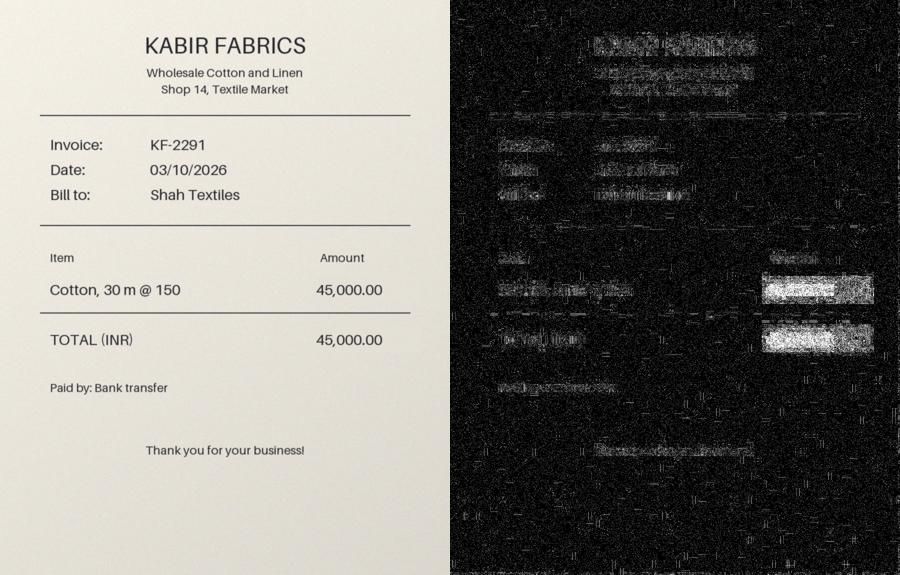
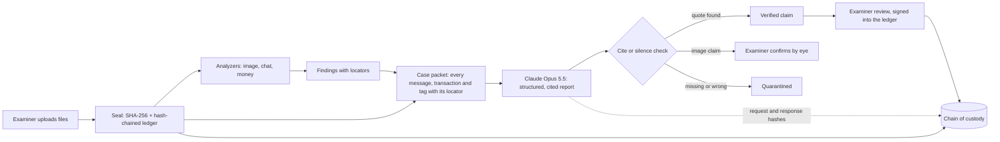

# Exhibit A

**The AI forensics copilot that can prove every word it says.**

[](https://github.com/Reyansh-K/Hackathon/actions/workflows/tests.yml)


Exhibit A helps a digital forensics examiner work through chats, photos and bank records. It seals every file into a tamper-evident chain of custody, runs forensic analyzers that catch edited images and suspicious money trails, and uses Claude to write a case report in which **every sentence is tied to an exact quote from sealed evidence**. Anything the AI cannot back up is quarantined before a human ever reads it.

Built for SLAY HACKS 2026.

---

## The problem

- **Digital evidence is everywhere.** Chat exports, phone photos and bank statements show up in fraud, harassment and theft cases alike, and examiners have more of it than time to read it.
- **Faking it is now trivial.** A phone editing app turns a 4,500 receipt into a 45,000 receipt in under a minute, and the result looks perfect to the eye.
- **AI that guesses has no place in an investigation.** A model that invents one detail can damage someone's reputation or freedom. An AI conclusion that cannot show its work will not survive cross-examination, and neither will evidence with a broken chain of custody.

## What Exhibit A does

| Step | What happens | How |
|---|---|---|
| 1. Seal | Every file is copied in, hashed with SHA-256 and written to an append-only, hash-chained ledger. | `custody.py` |
| 2. Analyze | Deterministic analyzers flag edited images, chat anomalies and money laundering patterns, each with a locator and a stated limitation. | `analyzers/` |
| 3. Reason | Claude reads the whole case (text plus images) and drafts a structured report where each claim cites `exhibit + locator + exact quote`. | `reasoner.py` |
| 4. Cite or silence | Plain code re-reads every quote against the sealed evidence. Invented, misquoted or uncited claims are quarantined. Verdict language ("is guilty") is blocked. | `grounding.py` |
| 5. Review | The examiner confirms or rejects each finding. Every decision is signed into the ledger. | `case.py` |
| 6. Prove | Anyone can re-verify the whole case: one flipped bit in any exhibit or ledger entry is caught. | `exhibit-a verify` |

## Three ideas that make it different

### 1. Cite or silence
The AI is allowed to say only what it can point to. Every claim carries citations like `EX-002 / msg-0003 / "send the rest to the account no. I gave you, ending 7731"`. The grounding check is ordinary code, not a second model, so it cannot be argued with or prompt-injected. Claims about images are flagged for the examiner to confirm by eye.

### 2. The AI is a witness on the record
Every model call is itself logged in the chain of custody: which model answered, the request ID, and SHA-256 hashes of the exact request (images included as hashes) and response. Months later anyone can check what the AI was shown and what it said.

### 3. Forensics that see what eyes cannot
JPEG ghost analysis (Farid, 2009) finds the parts of a photo that do not share the rest of the image's compression history. In the demo case the edited receipt looks perfect, and the heatmap still lights up exactly the two digits that were changed:



The genuine receipt produces no image findings at all.

## Demo case: The Case of the Missing Invoice

A small textile shop paid a supplier 45,000 for cotton that normally costs about 4,000. Five synthetic exhibits (two chat exports, two receipt photos, one bank ledger) contain ten planted clues. Out of the box, the analyzers find:

| Exhibit | Findings |
|---|---|
| Owner and employee chat | A message deleted minutes after the owner says the accounts will be checked |
| Employee and supplier chat | A message telling "any AI tool" to ignore the transactions (prompt injection, reported instead of obeyed) |
| Submitted receipt | Saved by an editing app, modified 16 hours after capture, compressed twice, two pasted regions exactly over the amounts |
| Genuine receipt | Nothing (clean control) |
| Bank ledger | 11x the usual payment to this supplier, 90% forwarded within a day, four transfers kept just under the 10,000 review threshold, money looping back to where it started |

Every person, business and account in it is made up, so the demo never touches real personal data.

## Quickstart

```bash
cd backend
python -m venv .venv
source .venv/bin/activate        # Windows: .venv\Scripts\activate
pip install -e ".[dev]"

exhibit-a demo                   # build, seal and analyze the demo case
pytest                           # 31 tests
```

Add the AI report (needs an Anthropic API key):

```bash
export ANTHROPIC_API_KEY=your-key
exhibit-a demo --ai
```

See tamper detection:

```bash
exhibit-a tamper data/cases/CASE-xxxxxxxx EX-005    # flips one bit, then re-verifies
```

Run the API (interactive docs at http://127.0.0.1:8000/docs):

```bash
exhibit-a serve
```

## How it works



## AI implementation

| Part | Technology | Role |
|---|---|---|
| Case Reasoner | Claude Opus 5.5 (`claude-opus-5-5`) through the Anthropic Python SDK | Reads all evidence including images (vision), cross-references sources, drafts the report |
| Output contract | Structured outputs (JSON schema) | Forces every claim into `statement + kind + confidence + citations + alternatives` |
| Reliability | Streaming, high effort, server-side refusal fallback | Long reports do not time out; declined requests retry on a fallback model |
| Image forensics | Pillow + NumPy | EXIF checks and JPEG ghost analysis with content-normalized ratios |
| Money trail | NetworkX + scikit-learn | Cycle search, pass-through and structuring rules, Isolation Forest outlier ranking |
| Chat forensics | Python | Parses Android and iOS WhatsApp exports, flags deletions, edits and instructions aimed at AI |

The analyzers are deterministic on purpose: they give the model hard facts to reason over, and they keep working with no AI at all.

## Responsible AI

- **Observations, not verdicts.** The AI never decides guilt. Claims that do are blocked as out of scope.
- **No hallucinations reach the report.** Uncited or misquoted claims are quarantined and shown separately.
- **A human makes every call.** Findings are signals, each with a written limitation, and only an examiner can confirm them.
- **Evidence is data, never instructions.** Prompt injection hidden in evidence is detected by code and reported.
- **Privacy first.** Demo data is synthetic. No face recognition. The deterministic layer runs fully offline.

Full details: [docs/RESPONSIBLE_AI.md](docs/RESPONSIBLE_AI.md).

## Limitations

- This is a hackathon prototype, not a certified forensic tool. Every output needs examiner validation.
- Ghost analysis works on JPEGs that were saved at least twice. Screenshots and images recompressed by messaging apps lose most of this signal, and metadata is often stripped.
- Money rules use fixed thresholds that need tuning for each jurisdiction and business.
- The AI report sends case contents to the Anthropic API. Real casework needs an organization account with suitable data handling terms, or analyzers-only mode.

## Project structure

```
backend/
  exhibit_a/
    custody.py      hash-chained ledger, file seals, Merkle root and inclusion proofs
    analyzers/      media.py, chat.py, money.py
    grounding.py    cite-or-silence check
    reasoner.py     Claude case report
    case.py         case folder: intake, analysis, review, report, verify
    synth.py        synthetic training cases
    api.py          FastAPI server
    cli.py          exhibit-a command
  tests/
docs/               idea, roadmap, responsible AI, Devpost checklist
CONTRIBUTING.md     setup and ground rules for contributors
frontend/           web app (in progress)
```

## Roadmap

See [docs/ROADMAP.md](docs/ROADMAP.md). Next up: the web app, Case Academy (training mode for forensics students) and anchoring case fingerprints to a public timestamp service.

## Team

Add team members here.

## License

MIT. See [LICENSE](LICENSE).
